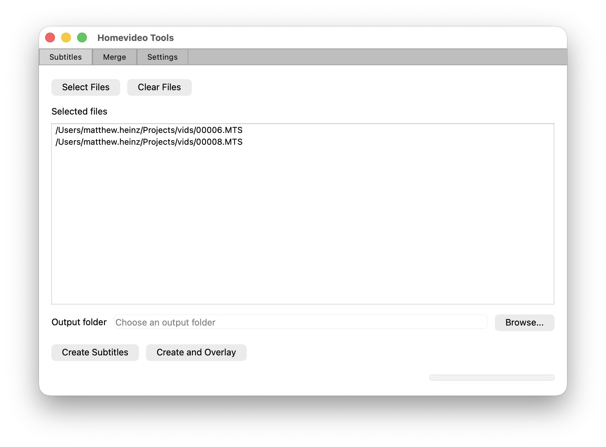
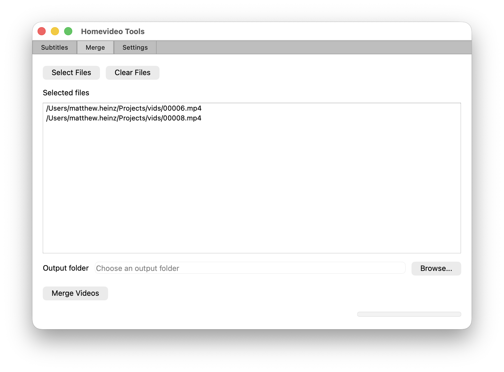
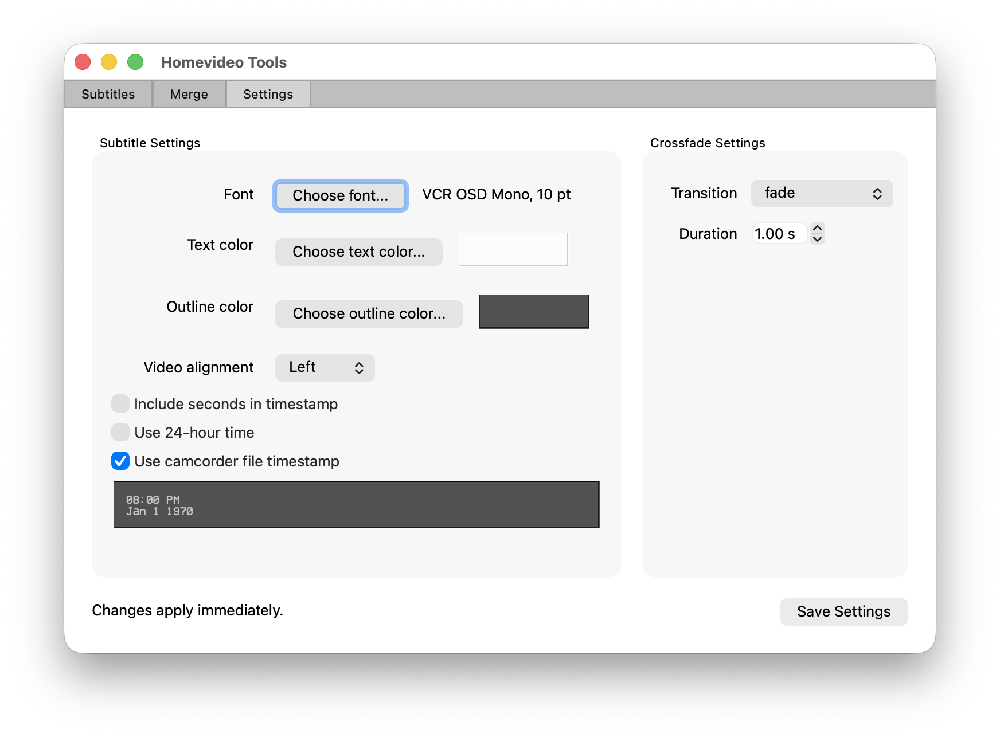
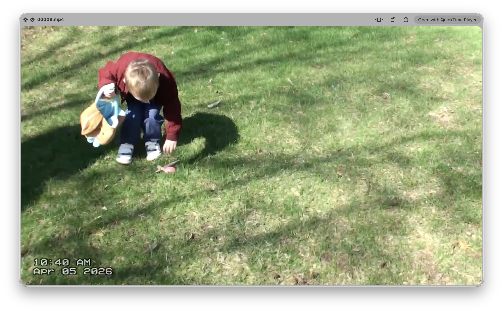
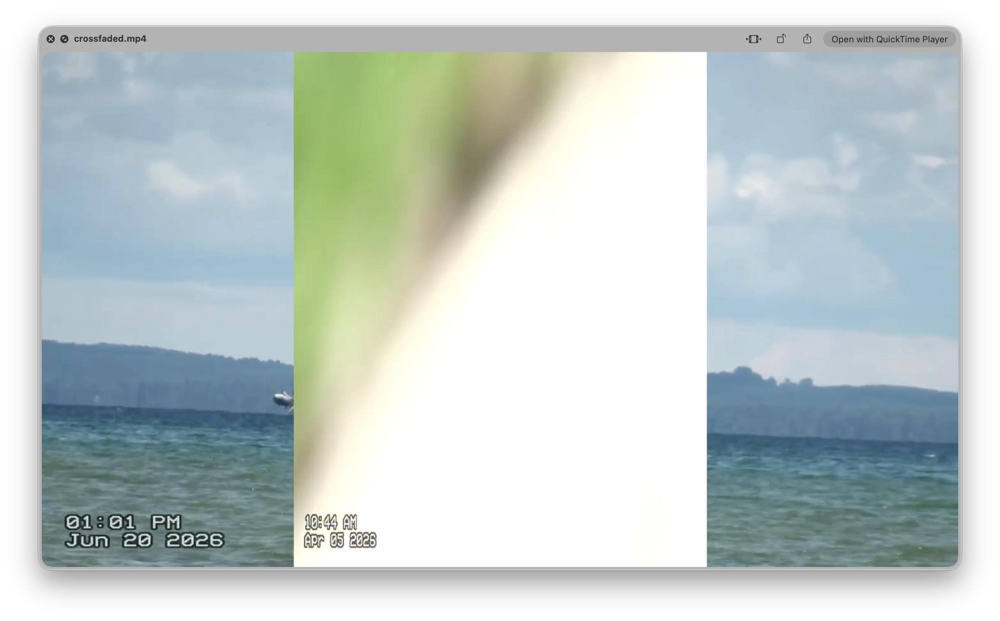

# Homevideo Tools

Homevideo Tools is a small PyQt6 desktop app for working with home videos:

- create timestamp subtitle files
- burn subtitles directly onto video
- merge multiple clips with a crossfade transition
- apply FFmpeg-based settings like subtitle font, color, alignment, and transition style

It is designed to be easy to run locally on a Mac or Windows machine, with bundled FFmpeg/FFprobe support preferred automatically when available.

## Features

### Subtitles
- choose one or more input videos
- create an `.srt` subtitle file from the source file timestamp
- optionally burn the subtitle overlay into the output video
- select font, text color, outline color, and alignment
- include or omit seconds and choose 12/24-hour time
- detect and apply deinterlacing when a source appears interlaced

### Merge
- combine multiple clips into one video
- use FFmpeg crossfade transitions such as `fade`, `wipeleft`, `slideleft`, and more
- set transition duration from the app settings
- detect and apply deinterlacing when a source appears interlaced

### Settings
- configure subtitle appearance
- configure crossfade transition and duration
- save settings in the app configuration file

### Timestamp source
The subtitle timestamp is derived from a file system timestamp, not from the video stream itself. In the subtitle settings, the checkbox labeled `Use camcorder file timestamp` controls which timestamp the app uses:

- checked: uses the file's `mtime` (modification time), which is often the right choice for camcorder recordings
- unchecked: uses the file's `ctime` (creation time), which is often the better default for phone-generated files

This matters because different cameras and phones store or preserve timestamps differently, and the app tries to match the most natural source for each type of footage.

## Quick start

1. Create and activate a virtual environment (optional but recommended)
2. Install dependencies
3. Launch the app

```bash
python3 -m venv .venv
source .venv/bin/activate
python -m pip install --upgrade pip
python -m pip install -r requirements.txt
python tool_gui.py
```

On macOS, the app will look for FFmpeg and FFprobe in the bundled `tools` folder first, then in common Homebrew locations if needed.

## App layout

The app contains three tabs:

- Subtitles
- Merge
- Settings

## Example screens

### Subtitle tab



### Merge tab



### Settings tab



### Example rendered video preview





## Typical workflow

### 1) Adjust the look
- Open the Settings tab
- Set subtitle colors, font, alignment, and timestamp style
- Choose a crossfade transition and duration

### 2) Create subtitles from a video
- Open the Subtitles tab
- Select one or more video files
- Choose an output folder or leave it blank to use the folder where the source video lives
- Click `Create Subtitles` or `Create and Overlay`

### 3) Merge clips together
- Open the Merge tab
- Select the clips to join
- Choose an output folder
- Click `Merge Videos`

## Notes

- If no output folder is selected, the app will typically write the result beside the source file.
- The bundled FFmpeg commands are generated by the app and can take advantage of hardware acceleration on macOS when available.
- The app depends on PyQt6 and the FFmpeg toolchain being present and usable.

## Repository layout

- `tool_gui.py` - Qt app entry point
- `gui_qt/` - tab and widget logic
- `homevideo_tools.py` - FFmpeg/video processing logic
- `tool_settings.py` - persisted app settings
- `tools/` - bundled FFmpeg and FFprobe binaries when included

## Example command-line usage

The project is primarily GUI-driven, but the underlying video processing functions use FFmpeg directly. For example, generating a subtitle overlay is essentially:

```bash
ffmpeg -i input.mp4 -vf "subtitles=filename=input.mp4.srt:force_style='Alignment=1,...'" -c:v libx264 -pix_fmt yuv420p output.mp4
```

The GUI handles this automatically for you.
